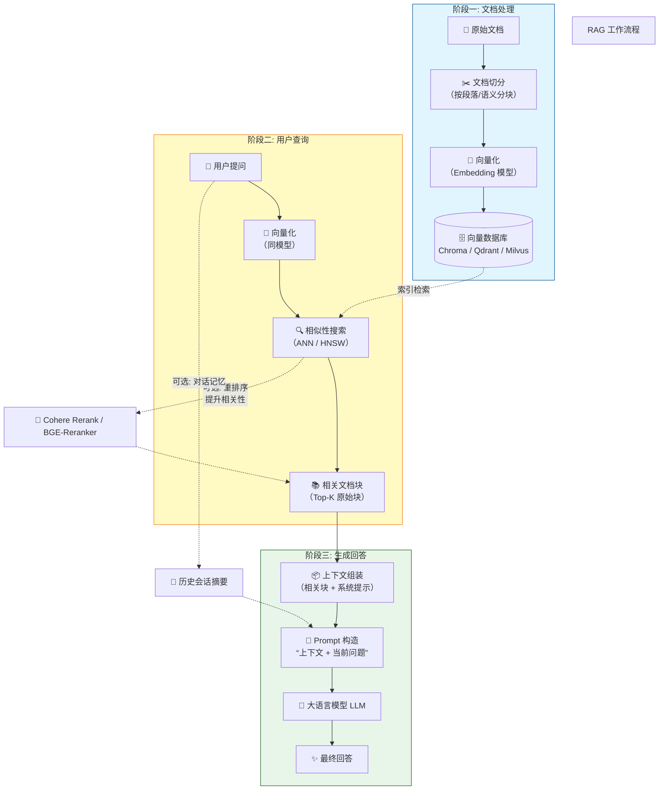

# 1.什么是RAG
RAG（Retrieval-Augmented Generation，检索增强生成）就是让AI先"查阅"你的文档，再回答问题。

    普通AI: 只能回答训练时学过的内容
    RAG AI: 可以回答你的私有文档里的内容
    
    
    举例说明:
    普通AI考试: 
        - 题目: 请回答问题
        - AI: 凭记忆回答（可能答不上来）
    RAG AI考试: 
        - 题目: 请回答问题
        - AI: 先查阅相关资料 → 找到答案 → 回答问题

# 2.为什么需要 RAG
## 举例1： 企业知识库
公司有大量内部文档：
* 1.技术规范文档
* 2.业务流程说明
* 3.历史项目文档
* 4.FAQ知识库

**问题**：新人想查某个技术规范，不知道在哪份文档里。
**RAG方案**：把所有文档导入，直接问AI"XX技术规范是什么"。

## 举例2： 代码库分析
项目有大量代码和文档：
* 1.需求文档
* 2.设计文档
* 3.API文档
* 4.代码注释

**问题**：想了解某个功能的实现，不知道从哪看起。
**RAG方案**：把代码和文档导入，问AI"XX功能是怎么实现的"。

## 举例3： 个人学习助手
自己积累了很多学习资料：
* 1.技术文章收藏
* 2.学习笔记
* 3.电子书

**问题**：想回顾某个知识点，找不到在哪。
**RAG方案**：把资料导入，问AI"XX知识点我笔记里是怎么写的"。

# 3. RAG 工作流程

### 1. 阶段1：文档处理（离线，只做一次）
>文档 → 切分 → 向量化 → 向量库. 
> 
>推荐采用语义分块（如按句子边界 + 重叠窗口），而非简单固定长度切分，以保留文档原意。向量模型建议使用 BAAI/bge‑large‑zh 或 text‑embedding‑3‑small。

| 步骤 | 说明 | 关键作用 | 
|----|------|----------|
| 文档 | 原始知识库（PDF、Word、网页等） | 提供事实性信息来源 |
| 切分/Chunking | 将长文档按固定长度/语义切分成小块 | 适配 LLM 上下文限制，提高检索精度 |
| 向量化/Embedding | 用 Embedding 模型将文本转为向量 | 让机器可以理解文本语义，用于相似度计算 |
| 向量数据库 | 存储所有文本向量 | 实现高效的相似性搜索 |

- 1.大模型 上下文窗口够大了 为什么还要切分
- 2.为什么要转成 向量
---

### 2. 阶段2：用户查询（在线，每次请求执行）
>用户提问 → 向量化 → 相似性搜索 → 相关文档块
> 
> 相似性搜索可使用 HNSW 索引加速。增加重排序环节，对粗排的 Top‑K 结果再精排，可显著提升最终问答准确率。
>
> 向量化: 把文字转成数字，让计算机能理解"相似"
>
> 向量数据库: 专门存向量的数据库，能快速找到相似内容
>
> Embedding模型: 负责把文字转成向量的模型
>
> 切分: 把长文档切成小块，方便检索

| 步骤 | 说明 | 关键作用 |
|------|------|----------|
| 用户提问 | 用户输入的问题 | 触发整个流程的入口 |
| 向量化/Embedding | 将用户问题转为向量 | 和知识库中的向量做匹配 |
| 相似性搜索 | 在向量库中查找和问题最相似的文档块 | 召回和问题相关的上下文信息 |
| 相关文档块/上下文 | 搜索得到的结果 | 作为“外部知识”喂给 LLM |

---

### 3. 阶段3：生成回答（在线，每次请求执行）
>上下文组装 → Prompt 构造 → LLM → 最终回答
> 
> Prompt 中应明确指示“仅根据提供的上下文回答，若无法回答则说不知道”。若需支持多轮对话，可加入虚线所示的对话记忆模块，将历史摘要注入 Prompt。

| 步骤 | 说明 | 关键作用 |
|------|------|----------|
| Prompt 组装 | 将「用户问题」和「相关文档块」拼接成完整 Prompt | 让 LLM 基于给定的事实来回答，避免幻觉 |
| LLM | 大语言模型 | 理解上下文并生成回答 |
| 最终回答 | LLM 输出的结果 | 既贴合用户问题，又基于真实文档，更准确、可信 |

---

# 4. RAG 主要技术栈

| 组件 | 方案 | 说明 |
|------|------|------|
| 向量数据库 | Chroma, Milvus, Pinecone | Chroma最简单，适合入门；Milvus高性能，适合大规模生产；Pinecone全托管云服务，免运维 |
| Embedding模型 | BGE, M3E, OpenAI | BGE国产开源，中文效果好；M3E轻量高效，中文场景优秀；OpenAI闭源商业模型，通用性强 |
| RAG框架 | LangChain, LlamaIndex | LangChain生态最全，组件丰富；LlamaIndex专精索引与检索，结构清晰 |
| LLM | DeepSeek, Claude, GPT | DeepSeek便宜好用，性价比高；Claude长上下文，推理能力强；GPT综合性能强，生态成熟 |

# 入门级的简单组合

`LangChain + Chroma + BGE + DeepSeek`

> 在将以上各个环节中的技术栈讲解完成后，会串联起来开始做 RAG 项目。

# 基础RAG（Naive RAG）
>是RAG技术最原始、最基本的形态。它确立的“检索-生成”协同工作范式，是所有后续高级RAG技术的基石。