## 一、数据库和数据库管理系统的概念
数据库：存放数据的地方，就像一个放文件的电子柜
数据库管理系统：用来管理这个电子柜的软件，比如帮你存入，查找，修改，删除数据
常见的数据库管理系统
    MYSQL 开源免费的小型数据库
    Oracle 收费的大型数据库
    SQLServer 收费的中型数据库

数据库管理系统
数据库
表
数据

## 二、安装mysql
MYSQL是一个开源的关系型数据库管理系统，使用SQL（结构化查询语言）进行数据操作，常和PHP,java,python等配合使用

下载：https://dev.mysql.com/downloads/installer/

安装步骤：

1.双击打开安装包
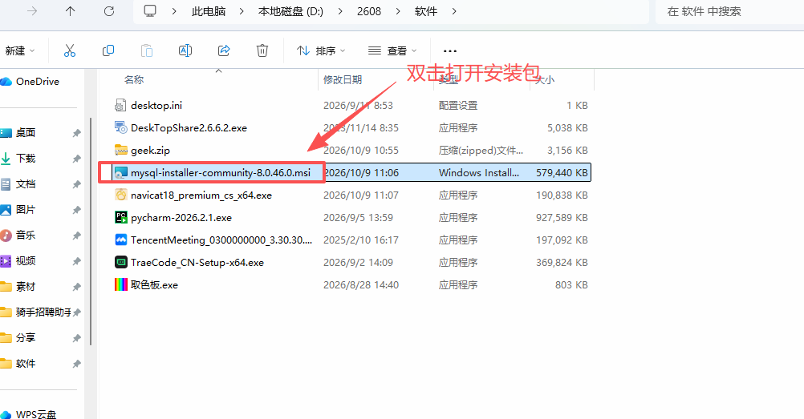
2.选择自定义安装
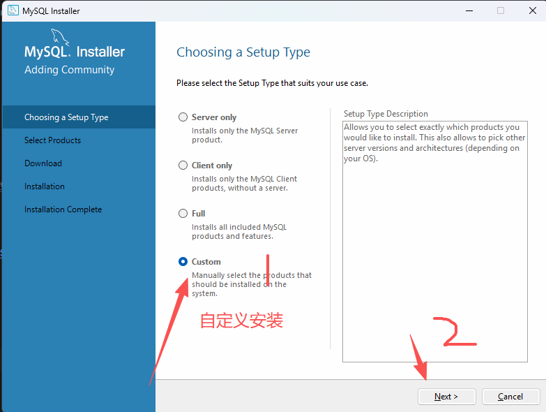
3.将server逐层展开，点击箭头放到右边那栏，然后点击右边那栏的server8.0.46,出现options,更改目录完毕点击ok
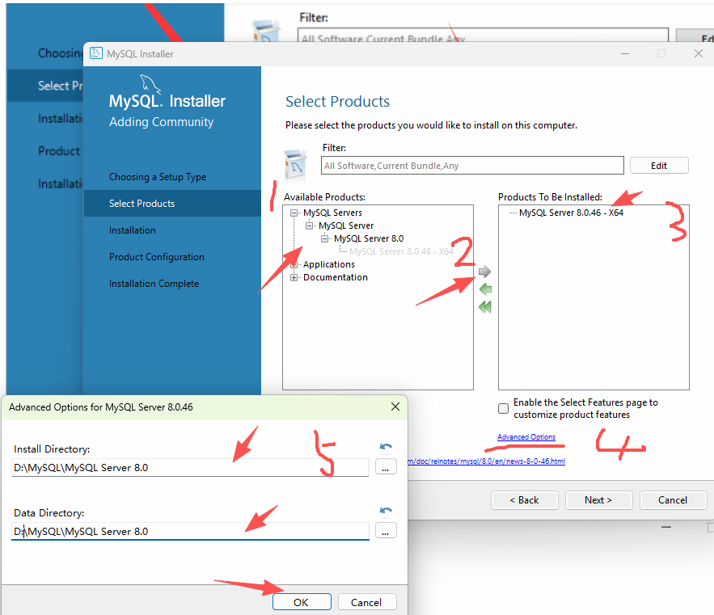
4.点击Execute 等待加载完毕100%之后 左侧变成绿色对号  再点击next，然后再next
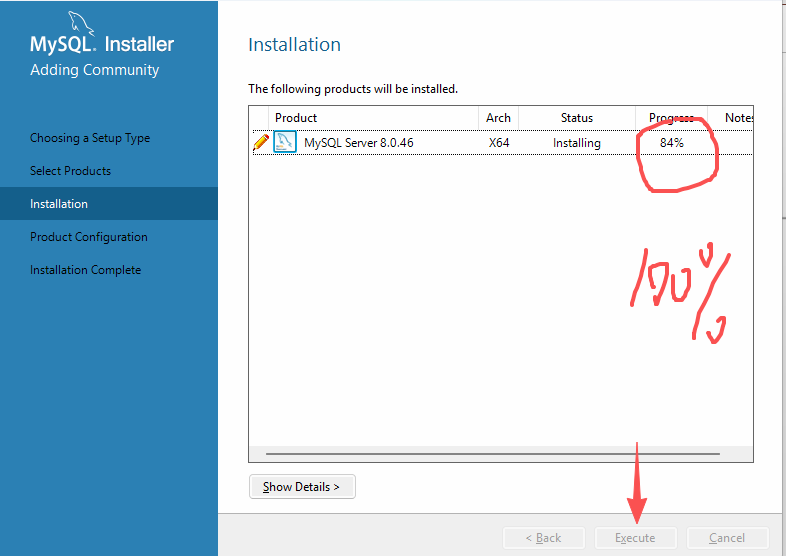
5.继续点击next  原来设置不建议修改
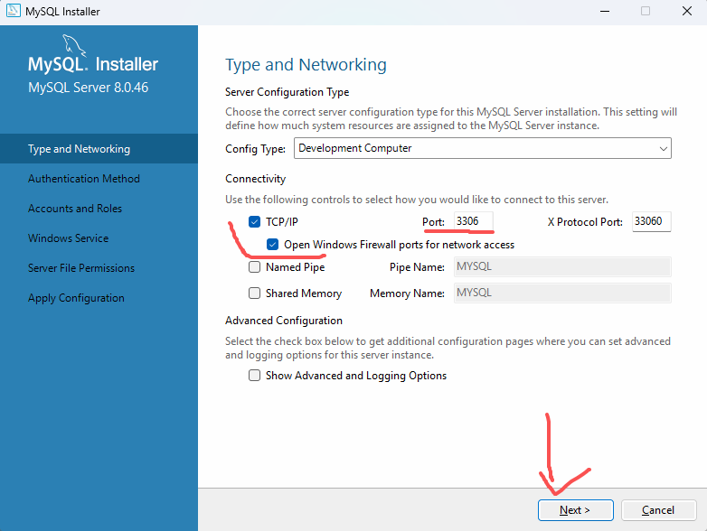
6.点击第二个选项 继续next
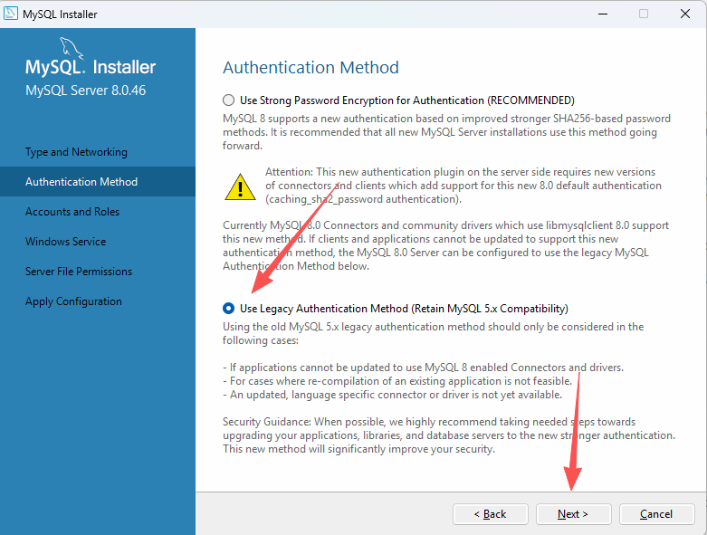
7.输入密码  一定要记住，再点击next 
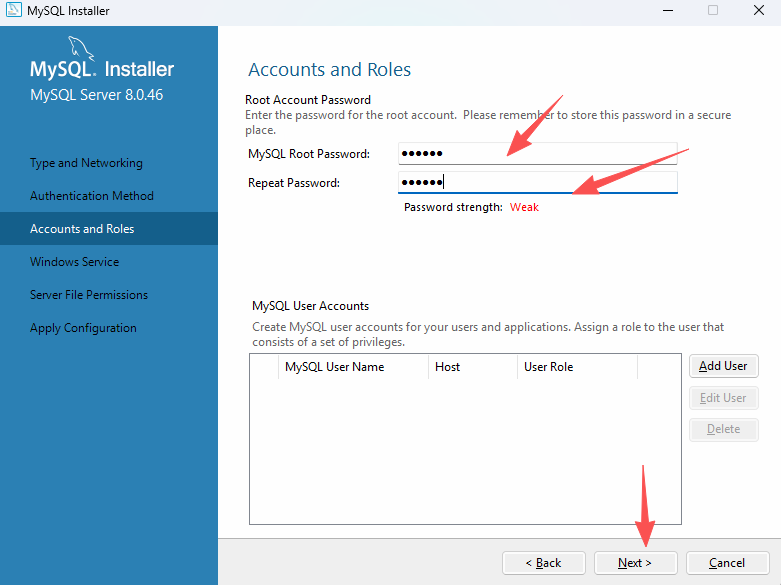
8.确保80端口没被占用  再次next
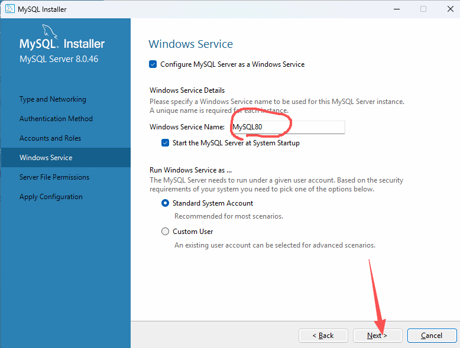
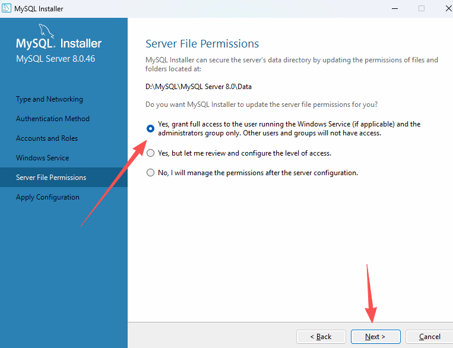
9.先点击execute 保证左侧都是绿色对号  然后安装完毕 finish
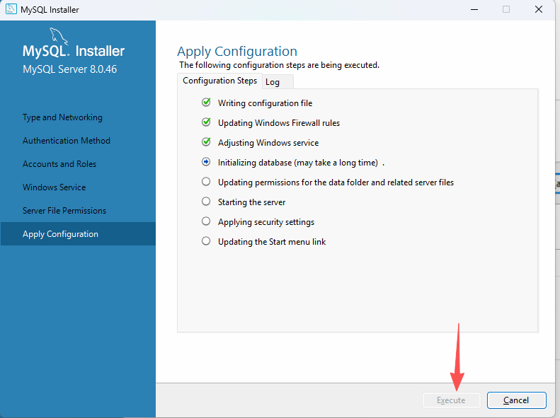
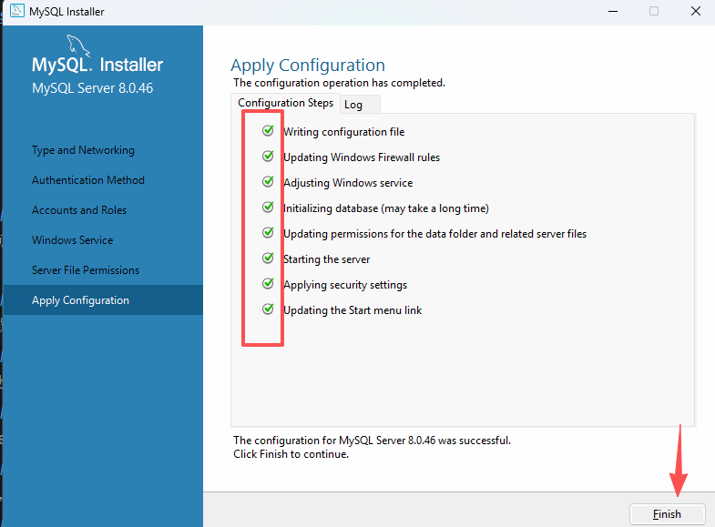

安装之后要配置好环境变量